<picture>
  <source media="(prefers-color-scheme: dark)" srcset="assets/github/banner-dark.svg">
  
</picture>

  <a href="https://victorabuchi.com"><b>victorabuchi.com</b></a> &nbsp;·&nbsp;
  <a href="https://victorabuchi.com/resume/">Résumé</a> &nbsp;·&nbsp;
  <a href="https://victorabuchi.com/projects/">Projects</a> &nbsp;·&nbsp;
  <a href="https://www.linkedin.com/in/victor-abuchi-06b086338">LinkedIn</a> &nbsp;·&nbsp;
  <a href="mailto:contact@victorabuchi.com">contact@victorabuchi.com</a>

### Live right now

<table>
  <tr>
    <td align="center" width="33%"> <b><a href="https://statiku.com">Statiku</a></b> Live analytics for websites and apps, from the first visit to the sale</td>
    <td align="center" width="33%"><a href="https://notchlight.com">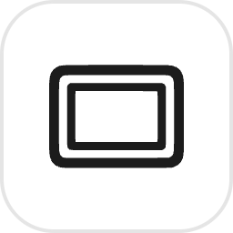</a> <b><a href="https://notchlight.com">Notchlight</a></b> Widgets on the Mac lock screen and a Dynamic Island around the notch</td>
    <td align="center" width="33%"><a href="https://slotnook.fi">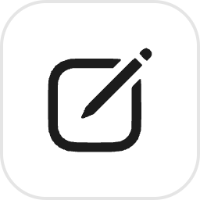</a> <b><a href="https://slotnook.fi">Slotnook</a></b> Booking for student housing, each organization on its own address</td>
  </tr>
  <tr>
    <td align="center"><a href="https://pursecast.com">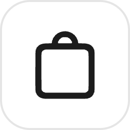</a> <b><a href="https://pursecast.com">Pursecast</a></b> Personal finance that forecasts your money like the weather</td>
    <td align="center"><a href="https://chronkeep.com">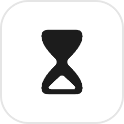</a> <b><a href="https://chronkeep.com">ChronKeep</a></b> A calendar that keeps reminding you until the assignment is done</td>
    <td align="center"><a href="https://onshipy.com">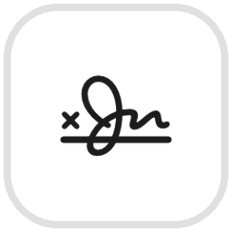</a> <b><a href="https://onshipy.com">Onshipy</a></b> Dropshipping automation that sells through Shopify</td>
  </tr>
</table>

**Client work:** [Kuopas](https://kuopas.com), a booking system and phone app for student housing in Kuopio, and [Rannikon](https://victorabuchi.com/case-studies/rannikon/), the timesheet platform a berry farm runs on for 300+ seasonal workers in five languages.

### A look inside

<table>
  <tr>
    <td colspan="2"> <b>Statiku:</b> the analytics for notchlight.com, Statiku's first customer</td>
  </tr>
  <tr>
    <td width="50%"><a href="https://pursecast.com">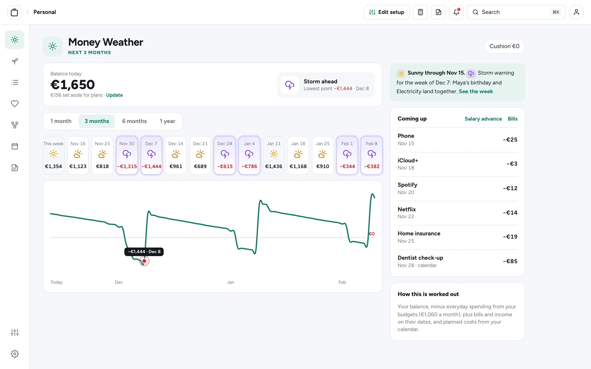</a> <b>Pursecast:</b> Money Weather, the balance forecast day by day</td>
    <td width="50%"><a href="https://slotnook.fi">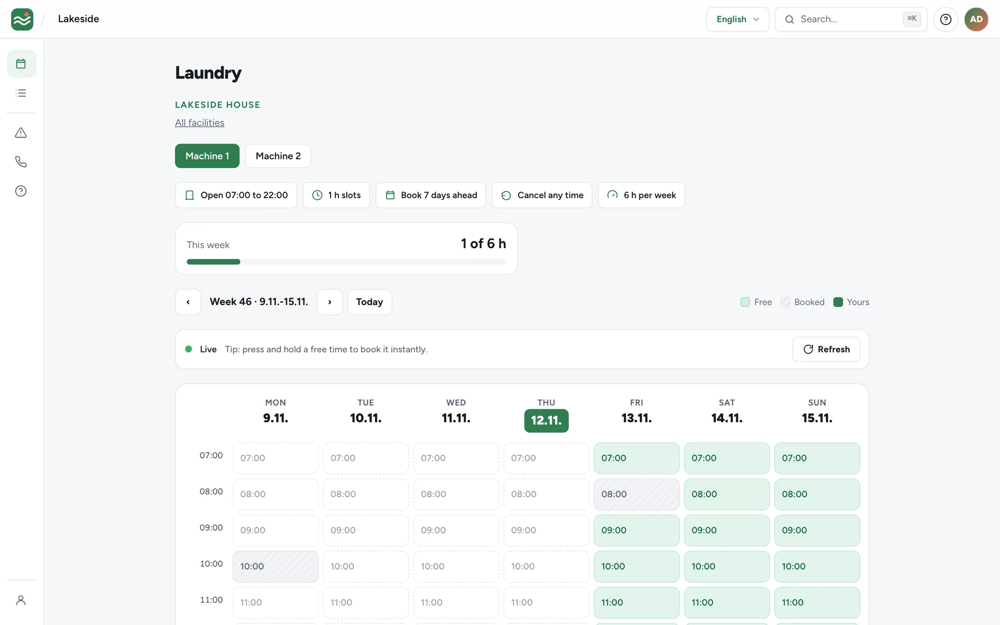</a> <b>Slotnook:</b> a laundry calendar under a housing organization's own brand</td>
  </tr>
  <tr>
    <td><a href="https://onshipy.com">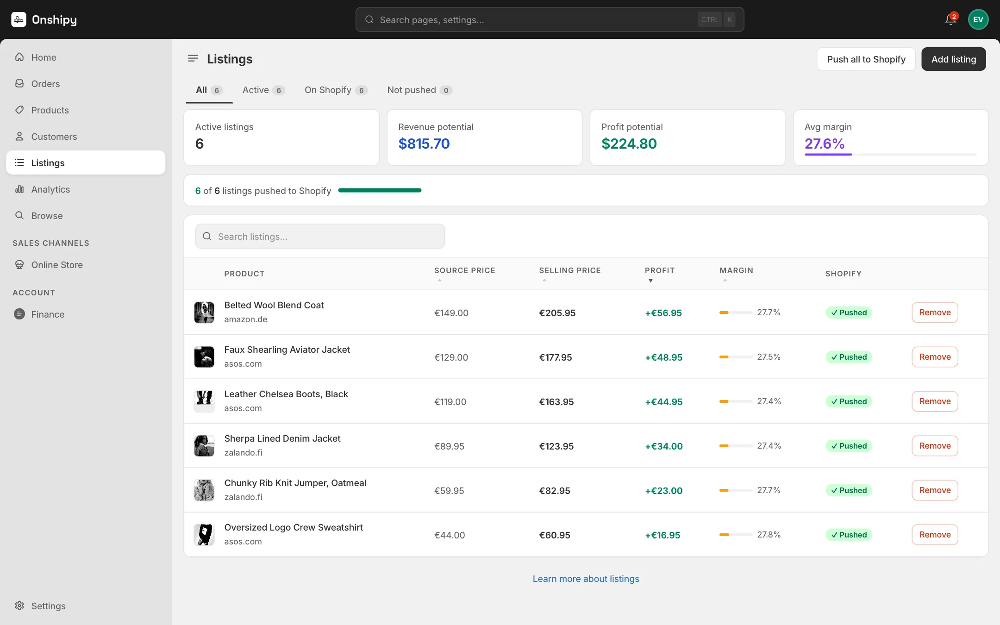</a> <b>Onshipy:</b> listings with their source price, selling price and profit, pushed to Shopify</td>
    <td><a href="https://chronkeep.com">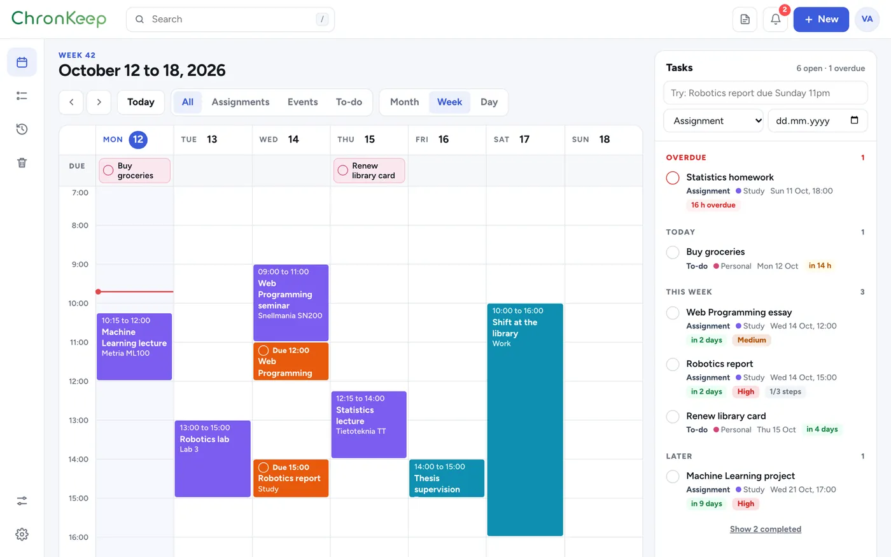</a> <b>ChronKeep:</b> the week's lectures and deadlines beside the tasks still to do</td>
  </tr>
</table>

### Mac apps

<table>
  <tr>
    <td width="50%"><b><a href="https://notchlight.com">Notchlight</a></b> Widgets on the lock screen and a Dynamic Island around the notch  <a href="https://notchlight.com">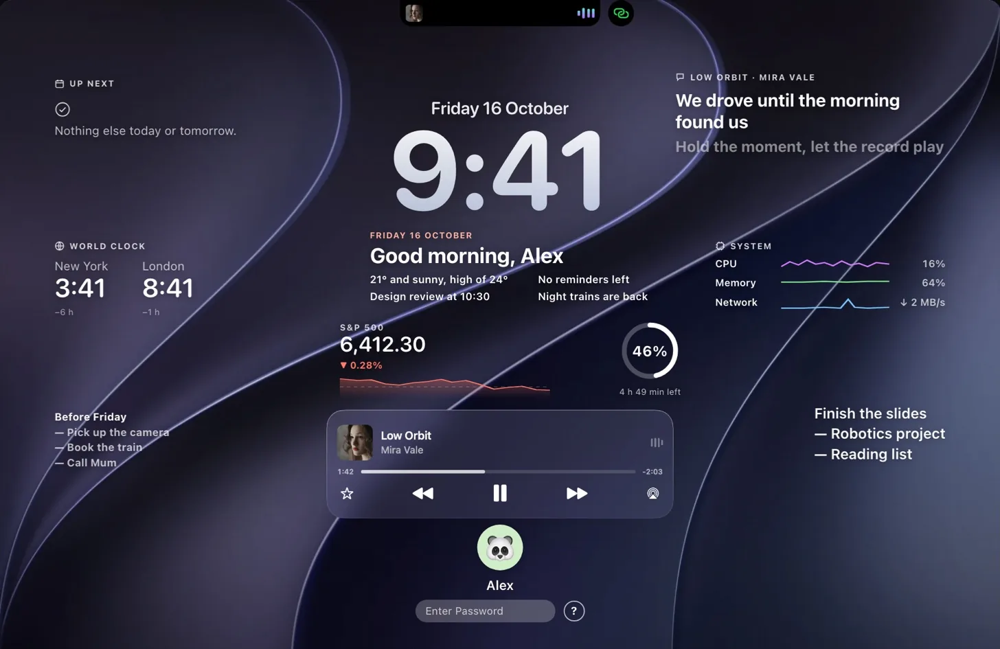</a></td>
    <td width="50%"><b><a href="https://victorabuchi.github.io/macxray/">MacXray</a></b> What your Mac is doing, live and in plain English  <a href="https://victorabuchi.github.io/macxray/">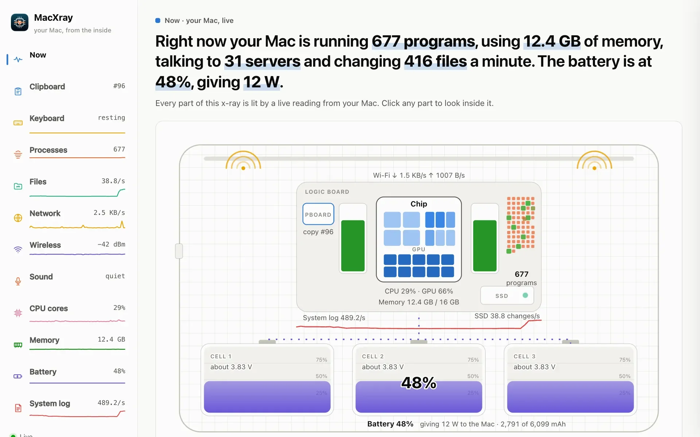</a></td>
  </tr>
  <tr>
    <td colspan="2"><b>Snake Bite</b> Classic Snake in 3D, with ten new mechanics that unlock as your best score climbs  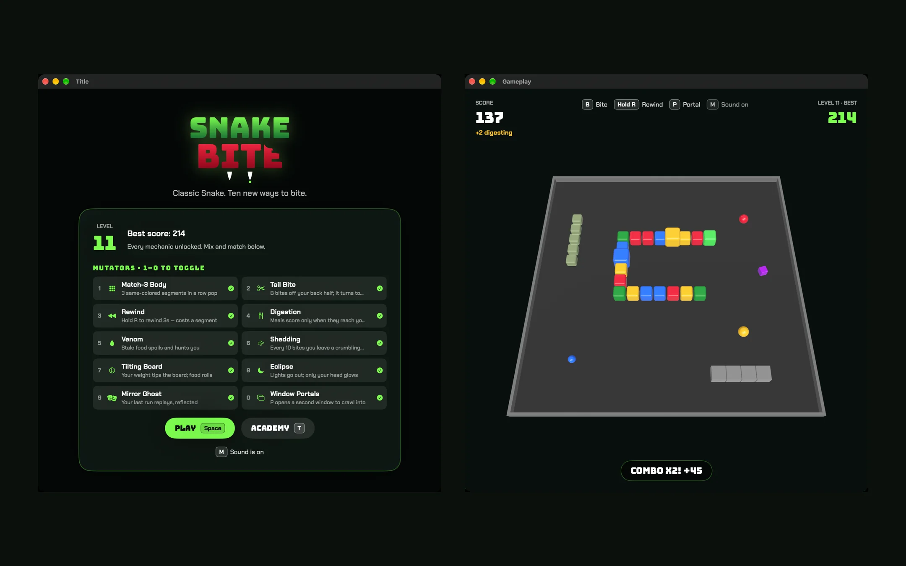</td>
  </tr>
</table>

### The stack, layer by layer

<picture>
  <source media="(prefers-color-scheme: dark)" srcset="assets/github/stack-dark.svg">
  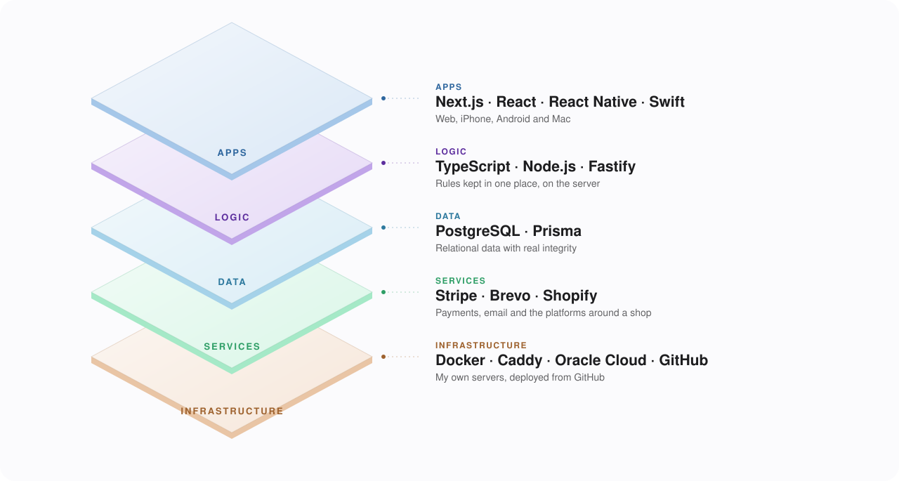
</picture>

Everything above runs on servers I set up and look after myself: Docker and Caddy on Oracle Cloud, deployed from GitHub, with nightly backups kept off the server.

- Building Statiku and moving my apps onto servers I run myself.
- Studying Computer Science at the University of Eastern Finland in Kuopio, and learning Finnish.
- Open to part-time work during my studies and full-time in the summer.
