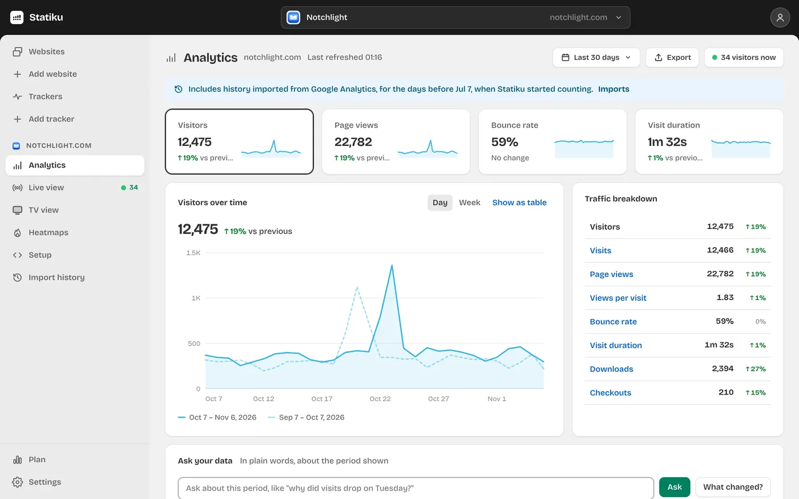
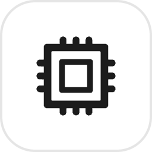

<picture>
  <source media="(prefers-color-scheme: dark)" srcset="assets/github/banner-dark.svg">
  
</picture>

  <a href="https://victorabuchi.com"><b>victorabuchi.com</b></a> &nbsp;·&nbsp;
  <a href="https://victorabuchi.com/resume/">Résumé</a> &nbsp;·&nbsp;
  <a href="https://victorabuchi.com/projects/">Projects</a> &nbsp;·&nbsp;
  <a href="https://www.linkedin.com/in/victor-abuchi-06b086338">LinkedIn</a> &nbsp;·&nbsp;
  <a href="mailto:contact@victorabuchi.com">contact@victorabuchi.com</a>

### Live right now

<table>
  <tr>
    <td align="center" width="33%"> <b><a href="https://statiku.com">Statiku</a></b> Live analytics for websites and apps, from the first visit to the sale</td>
    <td align="center" width="33%"> <b><a href="https://notchlight.com">Notchlight</a></b> Widgets on the Mac lock screen and a Dynamic Island around the notch</td>
    <td align="center" width="33%"> <b><a href="https://slotnook.fi">Slotnook</a></b> Booking for student housing, each organization on its own address</td>
  </tr>
  <tr>
    <td align="center"> <b><a href="https://pursecast.com">Pursecast</a></b> Personal finance that forecasts your money like the weather</td>
    <td align="center"> <b><a href="https://chronkeep.com">ChronKeep</a></b> A calendar that keeps reminding you until the assignment is done</td>
    <td align="center"> <b><a href="https://onshipy.com">Onshipy</a></b> Dropshipping automation that sells through Shopify</td>
  </tr>
</table>

**Client work:** [Kuopas](https://kuopas.com), a booking system and phone app for student housing in Kuopio, and [Rannikon](https://victorabuchi.com/case-studies/rannikon/), the timesheet platform a berry farm runs on for 300+ seasonal workers in five languages.

### Statiku: analytics for any website

Add one small script to any website (or WordPress, Shopify, Wix, Squarespace, Webflow or Framer) and see every visitor the moment they arrive: where they came from, what they read, and what they click and download. No cookies, no stored IP addresses, and the data stays in the EU. Mac and iPhone apps can report installs too.

**[Try it free for 30 days at statiku.com](https://statiku.com)**

### Mac apps

<table>
  <tr>
    <td align="center" width="33%"> <b><a href="https://notchlight.com">Notchlight</a></b> Widgets on the lock screen and a Dynamic Island around the notch</td>
    <td align="center" width="33%"> <b><a href="https://victorabuchi.github.io/macxray/">MacXray</a></b> What your Mac is doing, live and in plain English</td>
    <td align="center" width="33%"> <b>Snake Bite</b> Classic Snake in 3D, with ten new mechanics</td>
  </tr>
</table>

### The stack, layer by layer

<picture>
  <source media="(prefers-color-scheme: dark)" srcset="assets/github/stack-dark.svg">
  
</picture>

Everything above runs on servers I set up and look after myself: Docker and Caddy on Oracle Cloud, deployed from GitHub, with nightly backups kept off the server.

- Building Statiku and moving my apps onto servers I run myself.
- Studying Computer Science at the University of Eastern Finland in Kuopio, and learning Finnish.
- Open to part-time work during my studies and full-time in the summer.
